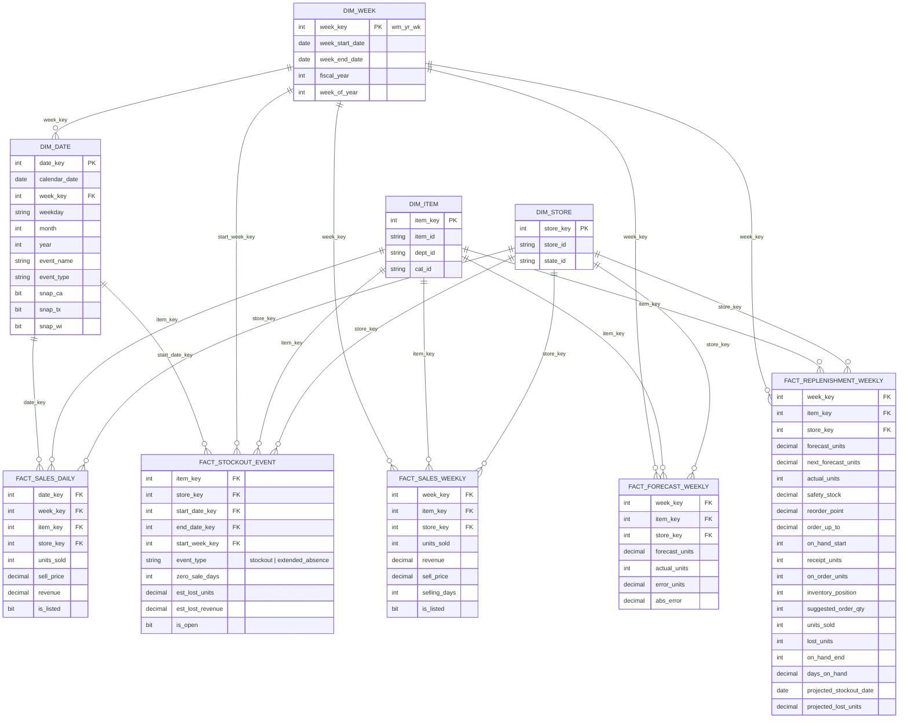

# Retail Replenishment Analytics — M5 (Walmart) Dataset

> From forecast to order: a SQL dimensional model and replenishment decision layer built on 30,000+ item × store series, with a Power BI report on top and a Tableau view to follow.

**Author:** Gil Hudes · [LinkedIn](https://linkedin.com/in/ghudes) · Microsoft Certified: Power BI Data Analyst Associate (PL-300)

---

## 1. The business problem

A planner needs to answer three questions every week for every item at every store:

1. **How much stock do I have, in days?** (days on hand, not raw units)
2. **What should I order, and how much?** (suggested order quantity)
3. **Where am I about to run out, and what will it cost?** (projected stockouts and lost units)

Most public dashboard portfolios stop at "sales went up." This project goes one step further and turns a demand forecast into replenishment decisions. That step is where analytics changes what a business does.

## 2. What this project demonstrates

| Area | What's here |
|---|---|
| Dimensional modeling | Star schema with conformed item, store, and date/week dimensions |
| SQL | Staging → model ETL in stored procedures, window functions, gaps-and-islands, set-based week-by-week simulation |
| Forecasting | A rolling one-week-ahead 4-week moving average, scored on WAPE and bias, with a top-error-contributors view |
| Replenishment logic | Days on hand, safety stock, reorder point, suggested order qty, projected stockout date, lost units; a 52-week inventory simulation showing what forecast error costs in stock and lost sales |
| Power BI | Semantic model, DAX measures, row-level security by state |
| Tableau *(planned)* | Public version of the out-of-stock risk view |
| Data quality | Row counts, duplicate-grain, orphan-key, and total reconciliation checks from raw files to every model table; the build stops if any fails |

### Beyond retail

The data is retail, but the pattern is general: **forecast demand → turn it into a decision → measure what being wrong costs.** The same structure shows up wherever a business commits resources ahead of uncertain demand.

| In this project | Finance | Tech / SaaS |
|---|---|---|
| Days on hand | Days cash on hand, runway | Capacity headroom |
| Safety stock | Liquidity buffer | Capacity buffer |
| Suggested order quantity | Funding or hedging decision | Provisioning or staffing decision |
| Stockout and lost units | Shortfall cost | SLA breach, lost revenue |
| Forecast WAPE and bias | Revenue or cash forecast accuracy | Usage or demand forecast accuracy |

## 3. Data source

**M5 Forecasting — Accuracy** (Walmart via Kaggle): https://www.kaggle.com/competitions/m5-forecasting-accuracy

- 3,049 items × 10 stores = **30,490 item-store series**
- 3 states (CA, TX, WI), 3 categories (Foods, Household, Hobbies), 7 departments
- 1,941 days of unit sales (Jan 29, 2011 – May 22, 2016); the calendar runs 28 days further
- Weekly sell prices; calendar with events and state-level SNAP days

Raw files are **not** committed. Run `data/download.md` instructions to fetch them.

| Raw file | Contents |
|---|---|
| `sales_train_evaluation.csv` | Wide daily unit sales (one column per day) |
| `sell_prices.csv` | Price by store, item, and Walmart week |
| `calendar.csv` | Date attributes, events, SNAP flags |

## 4. Architecture

**Platform:** SQL Server 2025 Express (free) → Power BI Desktop. All transformation logic is T-SQL in stored procedures; Power BI imports the finished weekly `dim_*` and `fact_*` tables it needs (see section 9).

```
Raw CSVs ─► stg.usp_load_staging ─► dbo.usp_build_dimensions ─► dbo.usp_build_sales_facts
            BULK INSERT +                                              │
            STRING_SPLIT unpivot          ┌────────────────────────────┴───────────────┐
                                          ▼                                            ▼
                               dbo.usp_build_forecast                    dbo.usp_build_stockouts
                               dbo.usp_build_forecast_accuracy           (historical, from daily sales)
                                          │
                                          ▼
                               dbo.usp_build_replenishment ─► dbo.usp_validate ─► Power BI
                               (52-week inventory simulation)
```

One command rebuilds everything: `EXEC dbo.usp_build_all @raw_dir = N'C:\m5\raw';`

## 5. Star schema



This is the full schema in SQL Server. Power BI imports only what the dashboards need: `dim_item`, `dim_store`, `dim_week`, and the replenishment and stockout facts, all joined at the week grain (section 9). `dim_date`, `fact_sales_daily`, `fact_sales_weekly`, and `fact_forecast_weekly` stay in SQL Server.

### Modeling decisions

- **Two grains.** `fact_sales_daily` (59.2M rows) stays in SQL Server for stockout inference. Power BI imports the 52-week replenishment fact (1.6M rows) and the stockout events, so the model stays small.
- **Weekly grain uses Walmart's `wm_yr_wk`** because prices are published at that grain.
- **SNAP flags live on `dim_date`** as one column per state (`snap_ca`, `snap_tx`, `snap_wi`).
- **Loading a 1,947-column file into SQL Server.** Tables max out at 1,024 columns, so each sales line is bulk-loaded as a single text value and unpivoted with `STRING_SPLIT(line, ',', 1)`. The ordinal identifies each value: positions 1–6 are ID fields, position *n* is day `d_(n−6)`. No wide table, no external tool.
- **Columnstore on the large tables** (`stg.sales_long` and the daily, weekly, forecast, and replenishment facts) for compression and fast aggregation.
- **Price is folded into `fact_sales_daily`** rather than a separate price fact, since every sales row needs it.
- **`is_listed` flag.** An item has no price in weeks before it was first stocked at a store. Those rows stay in the facts so every series has a complete calendar, but `is_listed = 0` marks them so they don't count as stockouts or forecast misses.

## 6. Replenishment logic

M5 contains sales, not inventory. **Inventory is simulated** under the assumptions in Section 7, and **historical stockouts are inferred** from sales patterns. The goal is to demonstrate the decision logic, not to recreate Walmart's actual inventory.

| Metric | Definition |
|---|---|
| Avg daily demand | Forecast weekly units ÷ 7 |
| Days on hand | `on_hand_end ÷ next week's avg daily demand` (the demand closing stock has to cover) |
| σ (forecast error) | RMSE of the series' last 13 weekly forecast errors (earlier weeks only) |
| Safety stock | `z × σ × √(L + R)` (lead time + review period, in weeks) |
| Order-up-to level | `forecast × (L + R) + safety stock` |
| Suggested order qty | Every week: `CEILING(order-up-to − inventory position)` when positive, where position = on hand + on order |
| Reorder point | `forecast × L + safety stock`. Reported, not used to trigger orders: stock below it won't last until an order placed today arrives, so it flags urgent series |
| Projected stockout date | When this week's forecast exceeds available stock: the day stock runs out at the forecast daily rate, before the next delivery |
| Projected lost units | `max(0, forecast − available stock)`: what the planner sees at review time |
| Simulated lost units | `max(0, actual demand − available stock)`: what actually happened |
| Inferred stockout event | Run of N to 28 consecutive zero-sale listed days, where N is too long to be chance for that series' sales rate (below) |
| Est. lost units (historical) | Zero-sale days × the series' average daily sales while on the shelf |

### Simulated replenishment: the cost of being wrong

`dbo.usp_build_replenishment` runs the policy above over the last 52 full weeks for every item × store. Each week it receives last week's order, reviews and orders against the forecast, then sells against M5's actual demand. The gap between what the forecast said and what happened is the cost of being wrong.

**Why it's a loop.** Each week opens with the previous week's closing stock, which depends on the previous week's order, so week *t* can't be computed before week *t* − 1. The procedure loops over the 52 weeks and handles all ~30,000 series in each pass with set-based statements. The loop's state is kept in two small tables (last week's stock, and orders in transit), so every pass costs the same.

**Results** (`dbo.replenishment_summary`, from the build):

| | Last 52 weeks |
|---|---|
| Forecast WAPE / bias | 38.2% / −0.8% |
| Fill rate (units sold ÷ demand) | 96.4% |
| Series-weeks with a stockout (target 5%) | 5.05% |
| Simulated lost units | 519k |
| Projected lost units (seen at review time) | 125k |
| Lost revenue | $1.56M |
| Average stock on hand | 409k units / $1.35M |
| Days on hand | 10.3 |

What it shows:

- **The policy lands close to its target.** z = 1.65 aims for stockouts in at most 5% of weeks; the simulation runs out in 5.05%, and sells 96.4% of demand.
- **Forecast error hides most of the risk from the planner.** At review time, the forecast shows 125k units at risk; 519k are actually lost. A 4-week average reacts late when demand jumps, so most shortfalls only show up after the order has gone out.
- **Fast sellers run out more often but lose a smaller share.** Series selling 30+ units a week stock out in 8.1% of weeks, against 2.1% for those selling under 1 a week, yet their fill rate is higher (96.8% vs. 94.0%). Their misses are frequent but small relative to demand.

**Why order every week.** Ordering only when inventory position falls to the reorder point (`forecast × L + safety stock`) sounds leaner, but with weekly review a skipped order leaves this week's stock to cover two weeks, and the reorder point only protects one. Ordering up to S every week sizes every order for the full L + R.

### Inferred historical stockouts

`dbo.usp_build_stockouts` finds every run of consecutive zero-sale days per item × store, using only listed days (`is_listed = 1`). It's a gaps-and-islands query: within a series, `day_num − ROW_NUMBER()` stays constant across consecutive zero days, so it labels each run.

**Threshold N, per series.** A run of zero days is normal for a slow seller and suspicious for a fast one, so one fixed N would flag the wrong series. If a series sells λ units a day on average and daily sales were Poisson, the chance of k zero days in a row is e^(−λk). N is the shortest run with less than a 1% chance:

```
N = CEILING( LN(100) / λ ),  at least 7 days      (dbo.fn_stockout_min_run_days)
```

| λ (units/day) | 5 | 1 | 0.5 | 0.1 | 0.02 |
|---|---|---|---|---|---|
| N (days) | 7 | 7 | 10 | 47 | 231 |

**Stockout vs. extended absence.** The first version flagged 21% of all listed days, mostly from runs lasting months or years (one item had no sales for 1,770 days while it had a price). That isn't an empty shelf waiting for the next delivery; the store wasn't really carrying the item. So the build makes two passes:

1. λ from all listed days. A run over 28 days that is also at least that pass's N is an **extended absence**: an assortment issue, not a replenishment one. It gets no lost-sales estimate.
2. λ again without the absence days, so it reflects demand while the item was on the shelf. A run from N to 28 days is a **stockout**.

A run that starts on the series' first listed day is never a stockout, because its start isn't visible (the item reaching the shelf after its price was published, or a run already under way when the data starts).

**Results** (α = 1%, from the build):

| | Value |
|---|---|
| Stockout events | 236,027 across 26,396 series |
| Stockout days | 3,028,758 (6.5% of 46.9M listed days) |
| Est. lost units | 3.54M (5.3% of units sold) · Foods 4.9%, Household 5.7%, Hobbies 7.3% |
| Est. lost revenue | $11.1M |
| Extended absences | 74,887 runs, 7.23M days |
| Series that can't show a stockout | 2,474 (they sell so slowly that N > 28) |

**Sensitivity to the threshold** (`dbo.stockout_sensitivity`):

| α | Stockouts | % of listed days | Est. lost units | % of units sold |
|---|---|---|---|---|
| 5% | 393,985 | 10.5% | 4.13M | 6.2% |
| **1% (used)** | **236,027** | **6.5%** | **3.54M** | **5.3%** |
| 0.1% | 137,835 | 3.9% | 2.99M | 4.5% |

The event count moves a lot with α, but lost units move much less. A series selling about 1 unit a day or more keeps N = 7 at every α here, so the runs a stricter test drops all come from slower sellers, which lose few units per day.

## 7. Assumptions

| Parameter | Value | Rationale |
|---|---|---|
| Lead time (L) | 1 week | A simple store-from-distribution-center setup: ordered at this week's review, received at next week's |
| Review cycle (R) | Weekly | Matches the forecast grain |
| Target service level (z) | 95% → 1.65 | Common retail default |
| σ for safety stock | RMSE of the last 13 weekly forecast errors | Sizes the buffer by how wrong this forecast has recently been for this series, so a worse forecast carries more stock |
| Ordering policy | Periodic review, order up to S every week, (R, S) | With weekly review, stock not topped up this week must last until next week's order arrives, so every order covers L + R |
| Order-up-to level (S) | L + R weeks of forecast + safety stock | Demand until the next order can arrive, plus the buffer |
| Starting inventory | Each series' order-up-to level in its first simulated week | Starts every series on policy, so results reflect the policy, not an arbitrary opening stock |
| Simulation window | Last 52 full weeks (fiscal week 11517 on) | The most recent full year; a series listed partway through joins once its forecast starts |
| Demand | M5 actual weekly units sold | No better demand signal exists; it already reflects Walmart's real stockouts |
| Unmet demand | Lost, not backordered | The standard assumption for a retail shelf: a shopper who finds it empty doesn't wait for next week's delivery |
| Stockout threshold N | Per series: `CEILING(LN(1/α) ÷ λ)`, at least 7 days | Shortest zero-sale run with probability < α under Poisson daily sales at the series' rate λ |
| Stockout test level (α) | 1% (5% and 0.1% reported for sensitivity) | Strict enough that chance runs are rare per run, loose enough to keep most real stockouts |
| Minimum run (floor on N) | 7 days | One week; keeps single quiet days on fast sellers from counting |
| Maximum stockout length | 28 days | Past four weeks, a missing item is an assortment issue, not a missed delivery; longer improbable runs are extended absences |
| Sales rate λ | Units ÷ listed days, excluding extended-absence days | Demand while the item was actually on the shelf |
| Historical lost units | Stockout days × λ; lost revenue uses each day's price | Same rate the threshold uses |

## 8. Forecast & accuracy

One forecast, in T-SQL (`dbo.usp_build_forecast`): a rolling one-week-ahead **4-week moving average**. The forecast for week *t* is the average units sold in weeks *t* − 1 … *t* − 4.

It's deliberately simple. The project's focus is what comes after the forecast: the order decision and what forecast error costs. A moving average is easy to explain, and has no parameters to tune.

- **Which weeks are forecast.** Listed weeks (`is_listed = 1`) with all 7 selling days, from a series' 5th listed week (the average needs 4 weeks of history). That's 6,566,711 series-weeks. The final, 2-day partial week is left out.
- **No look-ahead.** Each forecast for week *t* uses only actuals from earlier weeks (a rolling-origin evaluation).

**Metrics** (`dbo.usp_build_forecast_accuracy` → `dbo.forecast_accuracy`):

- **WAPE** = Σ|forecast − actual| ÷ Σ actual. Primary metric. MAPE divides each row's error by that row's actual, which is undefined for the many zero-sale weeks in M5 and explodes on 1-unit weeks. WAPE sums first, so it weights each series by volume and never divides by zero.
- **Bias** = Σ(forecast − actual) ÷ Σ actual. Positive means over-forecasting (excess stock), negative means under-forecasting (stockout risk).

**Results** (from the build):

| Window | WAPE | Bias |
|---|---|---|
| All weeks (Feb 2011 – May 2016) | 38.7% | +0.05% |
| Last 52 weeks (the simulation window) | 38.2% | −0.8% |
| Last 4 weeks (≈ M5's 28-day test period) | 34.7% | −2.7% |

**Top error contributors** (`dbo.forecast_top_errors`): every series ranked by its share of absolute error over the last 52 weeks, with a cumulative share. 4,630 of 30,490 series (15.2%) account for half of all absolute error, so review effort can go to a short list instead of the whole assortment.

## 9. Dashboards

### Power BI

A Power BI Desktop project in [`powerbi/`](powerbi/), saved in PBIP format so the model and report are text files that diff in git. It imports from the database the build creates. The server and database name are model parameters (Transform data → Edit parameters), so nothing in the file is machine-specific.

**Model.** `dim_item`, `dim_store`, `dim_week`, `fact_replenishment_weekly`, and `fact_stockout_event`. Both facts join to `dim_week`: replenishment on `week_key`, a stockout event on the week its zero-sale run starts (`start_week_key`). There is no daily date table, so auto date/time is off and dates show at week grain.

`fact_replenishment_weekly` carries each week's forecast, actual units, and absolute error (`abs_error`, the same column `fact_forecast_weekly` has in SQL), so forecast accuracy and its cost in stockouts come from the same rows. The validation build checks that its absolute error reconciles to the forecast fact's last 52 weeks. The trade-off: the report's accuracy view covers the simulated 52 weeks; the all-weeks figures in section 8 come from SQL.

| Page | Purpose |
|---|---|
| Suggested Order | Items to order in the selected week: quantity, inventory position against reorder point, days on hand, by store |
| Out-of-Stock Risk | Projected stockouts and lost units by item, store, state; inferred historical stockouts by category |
| Forecast Accuracy | WAPE / bias trend by week and department; top error contributors (share of absolute error, computed in DAX), over the last 52 weeks |

- RLS: CA, TX, and WI roles filter `dim_store[state_id]`, and the filter flows to every fact
- Screenshots: TODO

### Tableau Public
- Out-of-Stock Risk view: TODO (link)

## 10. Validation

`dbo.usp_validate` runs at the end of every build and stops it with an error if any check fails. The last full build passed all 64 checks. A selection:

| Check | Expected | Result |
|---|---|---|
| Series (item × store) | 30,490 | 30,490 ✓ |
| Sales days loaded / calendar days | 1,941 / 1,969 | 1,941 / 1,969 ✓ |
| `fact_sales_daily` rows | 59,181,090 | 59,181,090 ✓ |
| `fact_sales_weekly` rows (30,490 × 278 weeks) | 8,476,220 | 8,476,220 ✓ |
| Total units: staging = daily fact = weekly fact | Match | 66,927,173 in all three ✓ |
| Revenue: weekly fact vs. daily fact | Match | $191,577,546.04 in both ✓ |
| `fact_forecast_weekly` rows vs. eligible weeks rebuilt from `fact_sales_weekly` | Match | 6,566,711 ✓ |
| Absolute error: accuracy table and top-errors table vs. forecast fact | Match | ✓ |
| Stockout event days: every day is a listed zero-sale day in the daily fact | 0 exceptions | 0 ✓ |
| Stockout events that aren't whole runs, or are shorter than their series' N | 0 | 0 ✓ |
| `fact_replenishment_weekly` rows vs. last 52 weeks of the forecast fact | Match | 1,580,844 ✓ |
| Simulated demand vs. forecast fact actuals | Match | 14,511,900 ✓ |
| Simulation absolute error vs. forecast fact (last 52 weeks) | Match | 5,539,895.25 units ✓ |
| Simulation rows where stock doesn't balance, or a week doesn't open at last week's close | 0 | 0 ✓ |
| Orders not bringing position up to the order-up-to level | 0 | 0 ✓ |
| Duplicate grain in any fact | 0 | 0 ✓ |
| Orphan keys in any fact | 0 | 0 ✓ |

Full build time on SQL Server 2025 Express: about 37 minutes, most of it the staging load and the sales facts.

## 11. Repository structure

```
├── README.md
├── build.cmd                # one-command build: .\build.cmd [raw_dir]
├── build.sql                # SQLCMD script: deploys everything, then runs the build
├── data/
│   └── download.md          # how to get the M5 files (not committed)
├── sql/                     # T-SQL, SQL Server 2025 Express
│   ├── 00_setup/            # database (compat level 160) and schemas
│   ├── 01_staging/          # stg.usp_load_staging
│   ├── 02_dimensions/       # dbo.usp_build_dimensions
│   ├── 03_facts/            # daily and weekly sales facts
│   ├── 04_forecast/         # moving-average forecast, accuracy, top errors
│   ├── 05_replenishment/    # stockout inference, inventory simulation
│   ├── 06_validation/       # dbo.usp_validate
│   └── 99_orchestration/    # dbo.usp_build_all
├── powerbi/                 # Power BI project (PBIP): semantic model and report
├── tableau/                 # planned: link to the Tableau Public view
└── docs/                    # planned: screenshots
```

## 12. How to run

Requires SQL Server 2025 Express and Power BI Desktop (Windows).

1. Download the M5 files to `C:\m5\raw` ([`data/download.md`](data/download.md)).
2. From the repo root, run:
   ```
   .\build.cmd
   ```
   If the CSVs are somewhere other than `C:\m5\raw`, pass the folder: `.\build.cmd D:\data\m5`.

   The build connects to `localhost` (a default instance). For a named instance such as SQL Server Express, pass it as the second argument, `.\build.cmd C:\m5\raw localhost\SQLEXPRESS`, or set it once with `setx SQLCMDSERVER localhost\SQLEXPRESS`.

   This creates the `M5` database, deploys the procedures, loads and transforms the data, and prints every validation check. It stops with an error if any check fails. Requires `sqlcmd` on the PATH (`winget install sqlcmd` if missing).
3. Nothing needs editing per machine: `build.sql` uses repo-relative paths and gets the raw folder from `build.cmd`.
4. To rebuild later: `EXEC dbo.usp_build_all @raw_dir = N'C:\m5\raw';`
5. In Power BI Desktop: **Get data → SQL Server**, server `localhost` (or `localhost\SQLEXPRESS`), database `M5`, import the `dim_*` and `fact_*` tables.

## 13. Limitations & next steps

- Inventory is simulated, so suggested orders show the logic, not real stock positions
- Simulated demand is M5's units sold, which is already lower than true demand on days Walmart's shelf was empty, so simulated lost units understate what a real shortfall would cost
- Safety stock assumes forecast errors are roughly normal. Weekly item × store sales are lumpy and often zero, so the stockout rate varies by sales volume around the 5% that z = 1.65 targets: 2.1% of weeks for the slowest sellers, 8.1% for the fastest
- Orders are whole units with no case packs, minimum order quantities, or shelf capacity limits
- Inferred stockouts can't be distinguished from genuine zero-demand periods with certainty. M5 sales have more zero days than a Poisson model expects, so some flagged runs on slow sellers are chance. Testing many runs per series at α = 1% also produces some false flags
- The stockout threshold and lost units use one average rate per series, so they ignore seasonality, promotions, and price changes. A seasonal item's off-season can look like a stockout
- The 28-day line between a stockout and an extended absence is a judgment call; a long supplier outage would be counted as an absence
- The forecast is deliberately simple; the project's focus is the decision layer. A 4-week moving average has no seasonality or promotion effects, and it reacts late when demand jumps
- Next: feed a stronger forecast (for example one of M5's published benchmarks) into the same simulation and measure what the accuracy gain is worth in stock and lost sales
- Next: resolve SNAP to one state-specific flag per sales row, and test whether it improves the forecast

## 14. Why I built this

My day-to-day work includes demand forecasting across 30,000+ series, a Suggested Order dashboard used daily by production planners, and out-of-stock / lost-sales reporting for monthly S&OP. That work runs on proprietary data I can't share. This project rebuilds the same decision logic on public data so the approach can be reviewed end to end.
