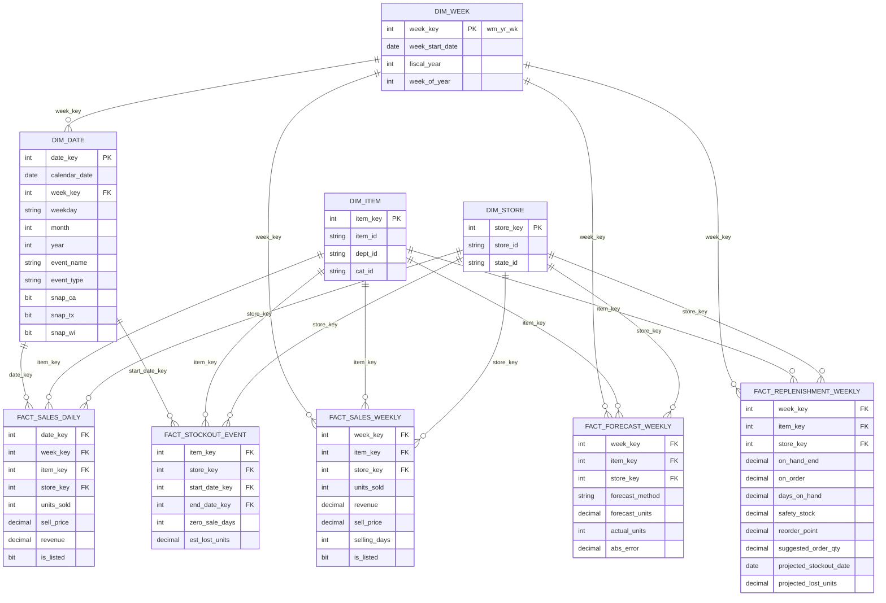

# Retail Replenishment Analytics — M5 (Walmart) Dataset

> From forecast to order: a SQL dimensional model, replenishment decision layer, and Power BI / Tableau dashboards built on 30,000+ item × store series.

**Author:** Gil Hudes · [LinkedIn](https://linkedin.com/in/ghudes) · Microsoft Certified: Power BI Data Analyst Associate (PL-300)

---

## 1. The business problem

A planner needs to answer three questions every week for every item at every store:

1. **How much stock do I have, in days?** (days on hand, not raw units)
2. **What should I order, and how much?** (suggested order quantity)
3. **Where am I about to run out, and what will it cost?** (projected stockouts and lost units)

Most public dashboard portfolios stop at "sales went up." This project goes one step further and turns a demand forecast into replenishment decisions. That step is where analytics changes what a business does.

## 2. What this project demonstrates

| Area | What's here |
|---|---|
| Dimensional modeling | Star schema with conformed item, store, and date/week dimensions |
| SQL | Staging → model ETL, views, stored procedures, window functions |
| Forecasting | Baseline weekly forecast with WAPE / bias tracking and error root-cause view |
| Replenishment logic | Days on hand, safety stock, reorder point, suggested order qty, projected stockout date, lost units |
| Power BI | Semantic model, DAX measures, row-level security by state |
| Tableau | Public version of the out-of-stock risk view |
| Data quality | Row-count and total reconciliation from raw files to model |

### Beyond retail

The data is retail, but the pattern is general: **forecast demand → turn it into a decision → measure what being wrong costs.** The same structure shows up wherever a business commits resources ahead of uncertain demand.

| In this project | Finance | Tech / SaaS |
|---|---|---|
| Days on hand | Days cash on hand, runway | Capacity headroom |
| Safety stock | Liquidity buffer | Capacity buffer |
| Suggested order quantity | Funding or hedging decision | Provisioning or staffing decision |
| Stockout and lost units | Shortfall cost | SLA breach, lost revenue |
| Forecast WAPE and bias | Revenue or cash forecast accuracy | Usage or demand forecast accuracy |

## 3. Data source

**M5 Forecasting — Accuracy** (Walmart via Kaggle): https://www.kaggle.com/competitions/m5-forecasting-accuracy

- 3,049 items × 10 stores = **30,490 item-store series**
- 3 states (CA, TX, WI), 3 categories (Foods, Household, Hobbies), 7 departments
- 1,941 days of unit sales (Jan 2011 – Jun 2016)
- Weekly sell prices; calendar with events and state-level SNAP days

Raw files are **not** committed. Run `data/download.md` instructions to fetch them.

| Raw file | Contents |
|---|---|
| `sales_train_evaluation.csv` | Wide daily unit sales (one column per day) |
| `sell_prices.csv` | Price by store, item, and Walmart week |
| `calendar.csv` | Date attributes, events, SNAP flags |

## 4. Architecture

**Platform:** SQL Server 2022 (Developer Edition, free) → Power BI Desktop. All transformation logic is T-SQL in stored procedures; Power BI imports the finished `dim_*` and `fact_*` tables.

```
Raw CSVs ──► stg.usp_load_staging ──► dbo.usp_build_dimensions / facts ──► Power BI (Get data → SQL Server)
             BULK INSERT +             forecast → inventory simulation
             STRING_SPLIT unpivot      → replenishment
```

One command rebuilds everything: `EXEC dbo.usp_build_all @raw_dir = N'C:\m5\raw';`

## 5. Star schema



### Modeling decisions

- **Two grains.** `fact_sales_daily` (59.2M rows) stays in SQL Server for stockout inference. Power BI reads the weekly facts (~8.5M rows) so the model stays fast.
- **Weekly grain uses Walmart's `wm_yr_wk`** because prices are published at that grain.
- **SNAP flags live on `dim_date`** as one column per state. TODO: compare against a state-specific `snap_flag` resolved onto the fact.
- **Loading a 1,947-column file into SQL Server.** Tables max out at 1,024 columns, so each sales line is bulk-loaded as a single text value and unpivoted with `STRING_SPLIT(line, ',', 1)`. The ordinal identifies each value: positions 1–6 are ID fields, position *n* is day `d_(n−6)`. No wide table, no external tool.
- **Columnstore on the large tables** (`stg.sales_long`, daily facts) for compression and fast aggregation; this also keeps the database well under SQL Server Express's 10 GB cap.
- **Price is folded into `fact_sales_daily`** rather than a separate price fact, since every sales row needs it.
- **`is_listed` flag.** An item has no price in weeks before it was first stocked at a store. Those rows stay in the facts so every series has a complete calendar, but `is_listed = 0` marks them so they don't count as stockouts or forecast misses.

## 6. Replenishment logic

M5 contains sales, not inventory. **Inventory is simulated** under the assumptions in Section 7, and **historical stockouts are inferred** from sales patterns. The goal is to demonstrate the decision logic, not to recreate Walmart's actual inventory.

| Metric | Definition |
|---|---|
| Avg daily demand | Forecast weekly units ÷ 7 |
| Days on hand | `on_hand_end ÷ avg daily demand` |
| Safety stock | `z × σ(daily demand) × √(lead time days)` |
| Reorder point | `avg daily demand × lead time + safety stock` |
| Suggested order qty | `max(0, order-up-to level − on_hand − on_order)` |
| Projected stockout date | First date simulated on-hand reaches 0 given forecast and inbound orders |
| Projected lost units | Forecast demand between projected stockout date and next receipt |
| Inferred stockout event | Run of ≥ N consecutive zero-sale days for an item that normally sells (TODO: set N) |
| Est. lost units (historical) | Zero-sale days × trailing avg daily sales before the event |

## 7. Assumptions

| Parameter | Value | Rationale |
|---|---|---|
| Lead time | TODO (e.g., 7 days) | |
| Review cycle | Weekly | Matches forecast grain |
| Target service level (z) | TODO (e.g., 95% → 1.65) | |
| Order-up-to level | TODO (e.g., ROP + 1 week of demand) | |
| Starting inventory | TODO (e.g., 2 weeks of demand) | |
| Stockout inference threshold (N) | TODO | |

## 8. Forecast & accuracy

- **Methods:** TODO — seasonal naive (same week last year) and trailing moving average as baselines
- **Primary metric: WAPE.** Many M5 series are intermittent with lots of zero weeks, so standard MAPE is undefined or unstable there.
- **Also tracked:** bias (over/under), MAPE on series above a volume threshold
- **Error root-cause view:** ranks the item × store series contributing the most absolute error each week

## 9. Dashboards

### Power BI
| Page | Purpose |
|---|---|
| Suggested Order | Items to order this week, quantity, days on hand, by store |
| Out-of-Stock Risk | Projected stockouts and lost units by item, store, state |
| Forecast Accuracy | WAPE / bias trend, top error contributors |

- RLS by `state_id` (CA / TX / WI roles)
- Screenshots: TODO
- `.pbix` file: TODO

### Tableau Public
- Out-of-Stock Risk view: TODO (link)

## 10. Validation

| Check | Expected | Result |
|---|---|---|
| Series count in `fact_sales_daily` | 30,490 | TODO |
| Total units: raw file vs. daily fact | Match | TODO |
| Total units: daily fact vs. weekly fact | Match | TODO |
| Distinct dates | 1,941 | TODO |
| Orphan keys in facts | 0 | TODO |

## 11. Repository structure

```
├── README.md
├── build.sql                # SQLCMD script: deploys everything, then runs the build
├── data/
│   └── download.md          # how to get the M5 files (not committed)
├── sql/                     # T-SQL, SQL Server 2022
│   ├── 00_setup/            # database (compat level 160) and schemas
│   ├── 01_staging/          # stg.usp_load_staging
│   ├── 02_dimensions/       # dbo.usp_build_dimensions
│   ├── 03_facts/
│   ├── 04_forecast/
│   ├── 05_replenishment/
│   ├── 06_validation/       # dbo.usp_validate
│   └── 99_orchestration/    # dbo.usp_build_all
├── powerbi/
│   └── replenishment.pbix
├── tableau/
│   └── link.md
└── docs/
    ├── star_schema.png
    ├── assumptions.md
    └── screenshots/
```

## 12. How to run

Requires SQL Server 2022 (Developer or Express) and Power BI Desktop (Windows).

1. Download the M5 files to `C:\m5\raw` ([`data/download.md`](data/download.md)).
2. Open `build.sql` and set `RepoDir` and `RawDir` at the top.
3. Run it, either in SSMS with **Query → SQLCMD Mode** on, or from a command prompt:
   ```
   sqlcmd -S localhost -E -C -i "C:\path\to\m5-retail-replenishment\build.sql"
   ```
   This creates the `M5` database, deploys the procedures, loads and transforms the data, and prints every validation check. It stops with an error if any check fails.
4. To rebuild later: `EXEC dbo.usp_build_all @raw_dir = N'C:\m5\raw';`
5. In Power BI Desktop: **Get data → SQL Server**, server `localhost`, database `M5`, import the `dim_*` and `fact_*` tables.

## 13. Limitations & next steps

- Inventory is simulated, so suggested orders show the logic, not real stock positions
- Inferred stockouts can't be distinguished from genuine zero-demand periods with certainty
- Baseline forecasts are intentionally simple; the project's focus is the decision layer
- TODO: next steps

## 14. Why I built this

My day-to-day work includes demand forecasting across 30,000+ series, a Suggested Order dashboard used daily by production planners, and out-of-stock / lost-sales reporting for monthly S&OP. That work runs on proprietary data I can't share. This project rebuilds the same decision logic on public data so the approach can be reviewed end to end.
