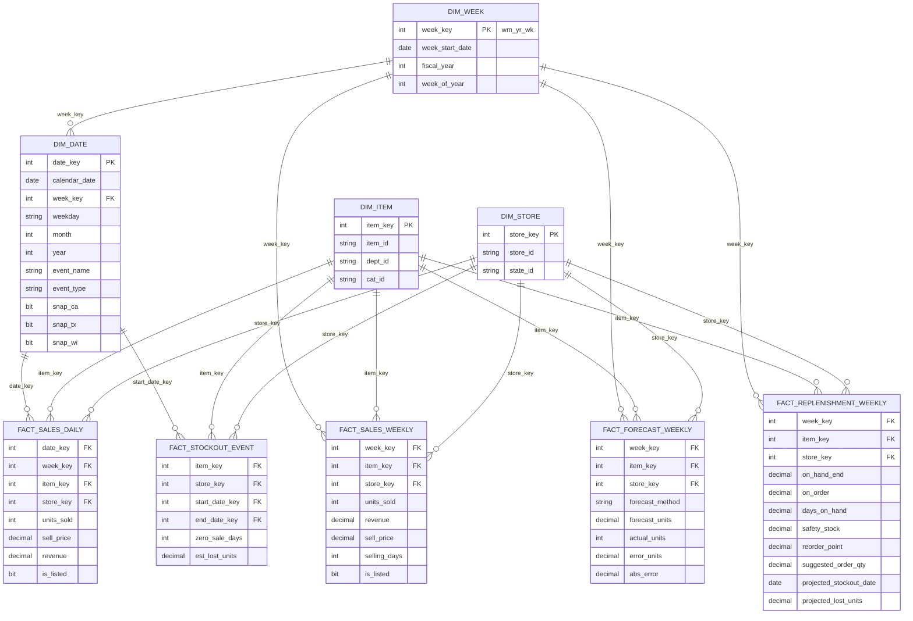

# Retail Replenishment Analytics — M5 (Walmart) Dataset

> From forecast to order: a SQL dimensional model, replenishment decision layer, and Power BI / Tableau dashboards built on 30,000+ item × store series.

**Author:** Gil Hudes · [LinkedIn](https://linkedin.com/in/ghudes) · Microsoft Certified: Power BI Data Analyst Associate (PL-300)

---

## 1. The business problem

A planner needs to answer three questions every week for every item at every store:

1. **How much stock do I have, in days?** (days on hand, not raw units)
2. **What should I order, and how much?** (suggested order quantity)
3. **Where am I about to run out, and what will it cost?** (projected stockouts and lost units)

Most public dashboard portfolios stop at "sales went up." This project goes one step further and turns a demand forecast into replenishment decisions. That step is where analytics changes what a business does.

## 2. What this project demonstrates

| Area | What's here |
|---|---|
| Dimensional modeling | Star schema with conformed item, store, and date/week dimensions |
| SQL | Staging → model ETL, views, stored procedures, window functions |
| Forecasting | Weekly seasonal naive, moving average, and Holt-Winters forecasts scored on WAPE and bias, with a top-error-contributors view |
| Replenishment logic | Days on hand, safety stock, reorder point, suggested order qty, projected stockout date, lost units |
| Power BI | Semantic model, DAX measures, row-level security by state |
| Tableau | Public version of the out-of-stock risk view |
| Data quality | Row-count and total reconciliation from raw files to model |

### Beyond retail

The data is retail, but the pattern is general: **forecast demand → turn it into a decision → measure what being wrong costs.** The same structure shows up wherever a business commits resources ahead of uncertain demand.

| In this project | Finance | Tech / SaaS |
|---|---|---|
| Days on hand | Days cash on hand, runway | Capacity headroom |
| Safety stock | Liquidity buffer | Capacity buffer |
| Suggested order quantity | Funding or hedging decision | Provisioning or staffing decision |
| Stockout and lost units | Shortfall cost | SLA breach, lost revenue |
| Forecast WAPE and bias | Revenue or cash forecast accuracy | Usage or demand forecast accuracy |

## 3. Data source

**M5 Forecasting — Accuracy** (Walmart via Kaggle): https://www.kaggle.com/competitions/m5-forecasting-accuracy

- 3,049 items × 10 stores = **30,490 item-store series**
- 3 states (CA, TX, WI), 3 categories (Foods, Household, Hobbies), 7 departments
- 1,941 days of unit sales (Jan 2011 – Jun 2016)
- Weekly sell prices; calendar with events and state-level SNAP days

Raw files are **not** committed. Run `data/download.md` instructions to fetch them.

| Raw file | Contents |
|---|---|
| `sales_train_evaluation.csv` | Wide daily unit sales (one column per day) |
| `sell_prices.csv` | Price by store, item, and Walmart week |
| `calendar.csv` | Date attributes, events, SNAP flags |

## 4. Architecture

**Platform:** SQL Server 2025 Express (free) → Power BI Desktop. All transformation logic is T-SQL in stored procedures; Power BI imports the finished `dim_*` and `fact_*` tables.

```
Raw CSVs ──► stg.usp_load_staging ──► dbo.usp_build_dimensions / facts ──► Power BI (Get data → SQL Server)
             BULK INSERT +             forecast → inventory simulation
             STRING_SPLIT unpivot      → replenishment
```

One command rebuilds everything: `EXEC dbo.usp_build_all @raw_dir = N'C:\m5\raw';`

## 5. Star schema



### Modeling decisions

- **Two grains.** `fact_sales_daily` (59.2M rows) stays in SQL Server for stockout inference. Power BI reads the weekly facts (~8.5M rows) so the model stays fast.
- **Weekly grain uses Walmart's `wm_yr_wk`** because prices are published at that grain.
- **SNAP flags live on `dim_date`** as one column per state. TODO: compare against a state-specific `snap_flag` resolved onto the fact.
- **Loading a 1,947-column file into SQL Server.** Tables max out at 1,024 columns, so each sales line is bulk-loaded as a single text value and unpivoted with `STRING_SPLIT(line, ',', 1)`. The ordinal identifies each value: positions 1–6 are ID fields, position *n* is day `d_(n−6)`. No wide table, no external tool.
- **Columnstore on the large tables** (`stg.sales_long`, daily facts) for compression and fast aggregation.
- **Price is folded into `fact_sales_daily`** rather than a separate price fact, since every sales row needs it.
- **`is_listed` flag.** An item has no price in weeks before it was first stocked at a store. Those rows stay in the facts so every series has a complete calendar, but `is_listed = 0` marks them so they don't count as stockouts or forecast misses.

## 6. Replenishment logic

M5 contains sales, not inventory. **Inventory is simulated** under the assumptions in Section 7, and **historical stockouts are inferred** from sales patterns. The goal is to demonstrate the decision logic, not to recreate Walmart's actual inventory.

| Metric | Definition |
|---|---|
| Avg daily demand | Forecast weekly units ÷ 7 |
| Days on hand | `on_hand_end ÷ avg daily demand` |
| Safety stock | `z × σ(daily demand) × √(lead time days)` |
| Reorder point | `avg daily demand × lead time + safety stock` |
| Suggested order qty | `max(0, order-up-to level − on_hand − on_order)` |
| Projected stockout date | First date simulated on-hand reaches 0 given forecast and inbound orders |
| Projected lost units | Forecast demand between projected stockout date and next receipt |
| Inferred stockout event | Run of ≥ N consecutive zero-sale days for an item that normally sells (TODO: set N) |
| Est. lost units (historical) | Zero-sale days × trailing avg daily sales before the event |

## 7. Assumptions

| Parameter | Value | Rationale |
|---|---|---|
| Lead time | TODO (e.g., 7 days) | |
| Review cycle | Weekly | Matches forecast grain |
| Target service level (z) | TODO (e.g., 95% → 1.65) | |
| Order-up-to level | TODO (e.g., ROP + 1 week of demand) | |
| Starting inventory | TODO (e.g., 2 weeks of demand) | |
| Stockout inference threshold (N) | TODO | |

## 8. Forecast & accuracy

Three one-week-ahead forecasts per item × store × week, all in T-SQL (`dbo.usp_build_forecast`):

| Method | Forecast for week *t* |
|---|---|
| `seasonal_naive` | Units sold in week *t* − 52 |
| `moving_avg_4` | Average units of weeks *t* − 1 … *t* − 4 |
| `holt_winters` | Additive Holt-Winters: level + trend + 52-week seasonal index, updated every week. α = 0.4, β = 0, γ = 0.6, tuned on earlier weeks (below). Floored at 0. |

- **Which weeks are forecast.** Listed weeks (`is_listed = 1`) with all 7 selling days, starting after a series' first 52 listed weeks (the seasonal methods need a year of history). For the 10,932 series stocked from the start of the data, that's fiscal 2012 onward; a series stocked later starts a year after it's first listed. All three methods forecast the same 5,106,234 series-weeks, so they compare like for like. The final, 2-day partial week is left out.
- **No look-ahead.** Each forecast for week *t* uses only actuals from earlier weeks (a rolling-origin evaluation).
- **Holt-Winters tuning** (`dbo.usp_tune_holt_winters`, run by hand, not part of the build). A grid search scores each α/β/γ set on unit WAPE over the weeks *before* the last 52 full weeks; the model never sees those 52 weeks, so they are a true holdout. One global set for all series, because per-series tuning on a year or two of noisy weekly sales would mostly fit noise. The search took three runs, each started where the last one's best value sat at the edge of its grid, and they agree where they overlap. The best values: α 0.4; β 0 (trend smoothing off: with a starting trend of 0, the model is effectively level + season); γ 0.6 (0.7 scored within 0.002 points, so the result isn't sensitive to it). Tuning-week WAPE fell from 56.0% with the original α 0.2 / β 0.05 / γ 0.1 to 49.9%. The winning values are fixed as defaults in `dbo.usp_build_forecast`, so the build stays deterministic.
- **Why Holt-Winters is a loop.** Each week's level, trend, and season depend on the previous week's, so it can't be one set-based query. The procedure loops over the ~225 weeks of history and updates all ~30,000 series in each pass, so it's 225 set-based statements rather than 30,000 × 225 row-by-row steps. Additive rather than multiplicative seasonality because many weeks sell 0 units.
- **52-week seasonality.** Fiscal 2013 has 53 weeks, so from fiscal 2014 a 52-week lag lands one fiscal week early. Both seasonal methods share this.

**Metrics** (`dbo.usp_build_forecast_accuracy` → `dbo.forecast_accuracy`):

- **WAPE** = Σ|forecast − actual| ÷ Σ actual. Primary metric. MAPE divides each row's error by that row's actual, which is undefined for the many zero-sale weeks in M5 and explodes on 1-unit weeks. WAPE sums first, so it weights each series by volume and never divides by zero.
- **Bias** = Σ(forecast − actual) ÷ Σ actual. Positive means over-forecasting (excess stock), negative means under-forecasting (stockout risk).

**Results** (WAPE / bias, from the build):

| Window | `moving_avg_4` | `holt_winters` | `seasonal_naive` |
|---|---|---|---|
| All weeks (fiscal 2012 – May 2016)¹ | 38.5% / −0.03% | 48.8% / +2.8% | 70.3% / +3.1% |
| Last 52 weeks (holdout) | 38.0% / −0.8% | 46.1% / +1.2% | 64.8% / −7.4% |
| Last 4 weeks (≈ M5's 28-day test period) | 34.6% / −2.7% | 42.0% / −4.3% | 59.5% / −14.3% |

¹ For Holt-Winters, "All weeks" includes the weeks its parameters were tuned on, so compare methods on the holdout.

Tuning cut Holt-Winters' holdout WAPE from 54.5% to 46.1% and its bias from +3.1% to +1.2%, but the simplest method still wins. The likely reason: at item × store × week, most series are low-volume and noisy, so "the same week last year" mostly repeats last year's noise, and Holt-Winters' seasonal indices are seeded from a single year of that same noise. A short moving average smooths the noise and tracks recent level, which is what matters for a one-week-ahead order. Tuning points the same way: it raised α (weight recent weeks more) and switched the trend off. Aggregating to department or store level averages out much of that noise, so estimating seasonality there and applying it to items is a natural next step (Section 13).

**Top error contributors** (`dbo.forecast_top_errors`): every series ranked by its share of each method's absolute error over the last 52 weeks, with a cumulative share. For `moving_avg_4`, 4,428 of 30,106 series (14.7%) account for half of all absolute error, so review effort can go to a short list instead of the whole assortment.

## 9. Dashboards

### Power BI
| Page | Purpose |
|---|---|
| Suggested Order | Items to order this week, quantity, days on hand, by store |
| Out-of-Stock Risk | Projected stockouts and lost units by item, store, state |
| Forecast Accuracy | WAPE / bias trend, top error contributors |

- RLS by `state_id` (CA / TX / WI roles)
- Screenshots: TODO
- `.pbix` file: TODO

### Tableau Public
- Out-of-Stock Risk view: TODO (link)

## 10. Validation

| Check | Expected | Result |
|---|---|---|
| Series count in `fact_sales_daily` | 30,490 | TODO |
| Total units: raw file vs. daily fact | Match | TODO |
| Total units: daily fact vs. weekly fact | Match | TODO |
| Distinct dates | 1,941 | TODO |
| Orphan keys in facts | 0 | TODO |

## 11. Repository structure

```
├── README.md
├── build.cmd                # one-command build: .\build.cmd [raw_dir]
├── build.sql                # SQLCMD script: deploys everything, then runs the build
├── data/
│   └── download.md          # how to get the M5 files (not committed)
├── sql/                     # T-SQL, SQL Server 2025 Express
│   ├── 00_setup/            # database (compat level 160) and schemas
│   ├── 01_staging/          # stg.usp_load_staging
│   ├── 02_dimensions/       # dbo.usp_build_dimensions
│   ├── 03_facts/
│   ├── 04_forecast/         # forecasts, Holt-Winters (shared + tuning), accuracy
│   ├── 05_replenishment/
│   ├── 06_validation/       # dbo.usp_validate
│   └── 99_orchestration/    # dbo.usp_build_all
├── powerbi/
│   └── replenishment.pbix
├── tableau/
│   └── link.md
└── docs/
    ├── star_schema.png
    ├── assumptions.md
    └── screenshots/
```

## 12. How to run

Requires SQL Server 2025 Express and Power BI Desktop (Windows).

1. Download the M5 files to `C:\m5\raw` ([`data/download.md`](data/download.md)).
2. From the repo root, run:
   ```
   .\build.cmd
   ```
   If the CSVs are somewhere other than `C:\m5\raw`, pass the folder: `.\build.cmd D:\data\m5`.

   The build connects to `localhost` (a default instance). For a named instance such as SQL Server Express, pass it as the second argument, `.\build.cmd C:\m5\raw localhost\SQLEXPRESS`, or set it once with `setx SQLCMDSERVER localhost\SQLEXPRESS`.

   This creates the `M5` database, deploys the procedures, loads and transforms the data, and prints every validation check. It stops with an error if any check fails. Requires `sqlcmd` on the PATH (`winget install sqlcmd` if missing).
3. Nothing needs editing per machine: `build.sql` uses repo-relative paths and gets the raw folder from `build.cmd`.
4. To rebuild later: `EXEC dbo.usp_build_all @raw_dir = N'C:\m5\raw';`
5. In Power BI Desktop: **Get data → SQL Server**, server `localhost` (or `localhost\SQLEXPRESS`), database `M5`, import the `dim_*` and `fact_*` tables.

## 13. Limitations & next steps

- Inventory is simulated, so suggested orders show the logic, not real stock positions
- Inferred stockouts can't be distinguished from genuine zero-demand periods with certainty
- Forecasts are deliberately simple; the project's focus is the decision layer. Holt-Winters uses one tuned parameter set for every series, and its seasonality is estimated per series from one year of history
- Next: estimate seasonality at department or store level and apply it to items
- TODO: next steps

## 14. Why I built this

My day-to-day work includes demand forecasting across 30,000+ series, a Suggested Order dashboard used daily by production planners, and out-of-stock / lost-sales reporting for monthly S&OP. That work runs on proprietary data I can't share. This project rebuilds the same decision logic on public data so the approach can be reviewed end to end.
